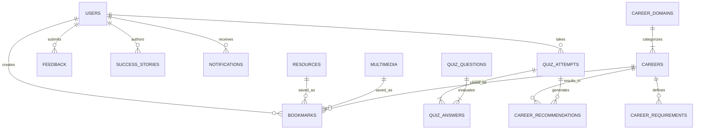

# PROJECT PROPOSAL

---

# PATHSEEKER — CAREER PASSPORT
### An Intelligent, Role-Aware Career Guidance and Career Discovery Platform

**Academic / Project Submission Document**

---

| **Document Information** | **Details** |
| :--- | :--- |
| **Project Title** | **PathSeeker — Next-Generation Career Passport & Guidance Ecosystem** |
| **Project Category** | Full-Stack Web Application / EdTech & Career Intelligence System |
| **Target Audience** | High School Students, University Graduates, Working Professionals & Career Advisors |
| **Technology Stack** | Angular 22 (SPA Frontend), Laravel 13 (PHP 8.4 REST API), MySQL Database, Docker |
| **Authentication & Security** | Laravel Sanctum, Role-Based Access Control (RBAC), CSRF/XSS Mitigation, BCRYPT (Rounds 12) |
| **Prepared By** | **Arham Arain** |
| **Repository Link** | [https://github.com/arain92/pathseeker](https://github.com/arain92/pathseeker) |
| **Submission Date** | November 2026 |

---

## 1. Executive Summary

In today's fast-evolving job market, students and young professionals face severe challenges navigating career choices due to fragmented information, mismatched skills, and a lack of structured self-assessment tools. Traditional career portals act merely as static job boards or unguided information repositories, failing to address the user's specific lifecycle stage—whether an exploratory high school student, a university graduate seeking entry-level positions, or an experienced professional transitioning into a new domain.

**PathSeeker** is an enterprise-grade, deterministic, and role-aware Career Guidance and Career Passport application designed to bridge this divide. Built on a modern decoupled architecture using an **Angular 22 Single Page Application (SPA)** and a robust **Laravel 13 REST API with MySQL**, PathSeeker provides a complete journey from self-discovery to career execution.

The platform offers:
- A personalized, lifecycle-aware **Career Passport** with dynamic profile completion tracking.
- A **deterministic, multi-factor Interest Assessment Engine** (20 Likert questions analyzing interests, skills, and engagement).
- A rich, searchable **Career Bank** with multi-parameter filtering and side-by-side comparative analysis.
- Curated multimedia learning resources and peer-reviewed community **Success Stories**.
- An end-to-end **Administrative Governance Center** for moderation, content updates, and feedback management.

---

## 2. Problem Statement & Motivation

### 2.1 The Current Crisis in Career Guidance
1. **Lack of Personalization**: Most existing career platforms deliver generic advice without considering whether the user is studying basic subjects, completing a specialized degree, or holding years of industry experience.
2. **Opaque & Biased Assessments**: Many online career quizzes rely on opaque or simplistic heuristic questionnaires that do not provide clear breakdowns of why specific careers are recommended.
3. **Fragmented Learning & Exploration**: Information about required skills, salary benchmarks, educational pathways, and verified success stories is scattered across dozens of unconnected websites.
4. **No Unified Progress Tracking**: Users have no dedicated digital "passport" to document their evolving competencies, bookmarks, personal notes, and assessment history in one secure environment.

### 2.2 Project Motivation
PathSeeker was conceived to eliminate guesswork in career selection. By providing an interactive, accessible, and mathematically deterministic platform, it empowers users to take ownership of their educational and professional future through verifiable evidence and data-driven insights.

---

## 3. Aims and Objectives

The primary aim of PathSeeker is to develop an accessible, secure, and scalable web platform that guides users systematically through their career journey.

### Specific Measurable Objectives:
- **Role-Aware Profile Architecture**: Implement dynamic user profiles tailored for **Students**, **Graduates**, and **Professionals**, each capturing lifecycle-specific data (e.g., current subjects, degrees, graduation years, industry experience, and transition targets).
- **Deterministic Assessment Engine**: Build an interactive 20-question psychological interest quiz that computes ranked career recommendations based on weighted dimensions (Interest + Skill Proficiency + Interaction History).
- **Comprehensive Career Directory**: Curate and index 40+ career paths across 10 specialized domains with dynamic search, salary bands, required qualifications, and real-time comparison capabilities.
- **Unified Saved Center & Notes**: Enable cross-entity bookmarking (careers, resources, multimedia, stories) with private notes, PDF report export, and native Web Share integration.
- **Enterprise-Grade Admin Panel**: Deliver an administrative dashboard for user moderation, role security, content publication, quiz maintenance, and a bi-directional feedback ticketing loop.
- **Universal Accessibility (WCAG 2.1 AA Compliant)**: Support Light/Dark/System visual modes, dynamic text scaling (Default, Larger, Largest), high-contrast accessibility, keyboard navigation, and reduced-motion states.

---

## 4. Scope of the System

```
                      +----------------------------------------------------+
                      |               PATHSEEKER ECOSYSTEM                 |
                      +----------------------------------------------------+
                                                |
         +--------------------------------------+--------------------------------------+
         |                                                                             |
         v                                                                             v
+-----------------------+                                                   +-----------------------+
|     PUBLIC ACCESS     |                                                   |  AUTHENTICATED PORTAL |
|  - Home & Highlights  |                                                   |  - Career Passport    |
|  - Public Career Bank |                                                   |  - Interest Quiz      |
|  - Career Comparison  |                                                   |  - Recommendations    |
|  - Learning Resources |                                                   |  - Saved Center & PDF |
|  - Video Transcripts  |                                                   |  - Story Submission   |
|  - Success Stories    |                                                   |  - Feedback Ticketing |
+-----------------------+                                                   +-----------------------+
                                                                                       |
                                                +--------------------------------------+
                                                |
                                                v
                                 +-----------------------------+
                                 |   ADMINISTRATOR DASHBOARD   |
                                 |  - User Management & Logs  |
                                 |  - Career CRUD & Domains    |
                                 |  - Quiz Question Editor     |
                                 |  - Story Moderation Queue   |
                                 |  - Feedback Resolution      |
                                 |  - Platform Announcements   |
                                 +-----------------------------+
```

### 4.1 In-Scope Capabilities
- Public exploration of career directories, comparative analysis matrices, and learning repositories without mandatory registration.
- Multi-tier authentication with email verification, password resets, and role protection via Laravel Sanctum tokens.
- Interactive multi-step career assessment with resume-later persistence.
- Exportable career passport and saved careers summary in print-optimized PDF format.
- Comprehensive REST API adhering to JSON-API specifications.

### 4.2 Out-of-Scope (Future Enhancements)
- Real-time video conferencing for 1-on-1 career mentorship.
- Direct job application submission and automated employer tracking (ATS).
- Machine learning models trained on external live labor market feeds (current seed values reflect standard demonstration catalogue statistics).

---

## 5. Stakeholder & Target User Analysis

| User Persona | Key Characteristics | System Features Utilized |
| :--- | :--- | :--- |
| **High School / College Student** | Exploring academic streams, understanding core interests, identifying foundation skills. | Career Passport (Student Mode), 20-Question Interest Quiz, Career Bank with entry-level filter, Video Explainer Hub. |
| **Recent University Graduate** | Holding specialized degrees, preparing for corporate entry, mapping qualifications to job titles. | Graduate Profile (Degree, GPA, Grad Year), Comparative Career Matrix, Educational Roadmap & Certification Guides. |
| **Working Professional** | Seeking career transition, upskilling, or lateral advancement in tech and management. | Professional Profile (Years of Experience, Current Industry, Target Goal), Skill Gap Analysis, Success Stories. |
| **System Administrator** | Ensuring platform safety, verifying story submissions, maintaining curriculum content. | Complete Administrative Suite, User Role Management, Content Moderation, Feedback Ticketing, Analytics. |

---

## 6. Functional Modules Breakdown

### Module 1: Authentication, Authorization & Security
- Secure registration capturing identity and role persona.
- State-of-the-art tokenized authentication using **Laravel Sanctum**.
- BCRYPT password hashing (12 rounds) with strict credential policies.
- Anti-account enumeration handling on password resets.
- Server-enforced Role-Based Access Control (`Student`, `Graduate`, `Professional`, `Administrator`).

### Module 2: The Career Passport (Dynamic Profile Engine)
- Contextual profile fields that dynamically reconfigure based on user role.
- Dynamic **Completion Metric**: Real-time percentage indicator computed from database evidence (contact info, bio, skills, goal, interests).
- Multi-skill proficiency management with ratings from Beginner to Expert.

### Module 3: Deterministic Interest Assessment & Recommendation Engine
- 20 psychometric Likert-scale questions covering 10 distinct career domains.
- Session-persistent state: Users can pause and resume assessments anytime.
- **Mathematical Scoring Formula**:
  $$\text{Match Score} = \alpha(\text{Quiz Dimension Fit}) + \beta(\text{Skill Overlap}) + \gamma(\text{User Interests}) + \delta(\text{Behavioral Views})$$
- Generates a Top-10 Ranked Career Match Report with historical comparison charts.

### Module 4: Career Bank & Intelligence Comparison
- 40+ seeded, high-detail career profiles (Roles, day-to-day duties, education requirements, salary ranges, demand ratings).
- Faceted filtering by salary range, demand level, education requirement, domain, and keywords with debounced search.
- **Side-by-Side Comparison Engine**: Select and contrast up to 3 careers simultaneously across all attributes.

### Module 5: Content, Multimedia & Learning Hub
- Centralized knowledge hub for downloadable guides, roadmaps, and cheat sheets.
- Rich multimedia portal supporting embedded videos, transcripts, audio, and user ratings.

### Module 6: Community Success Stories
- Peer-to-peer real-world career journey submissions structured across 5 career phases.
- Two-stage moderation pipeline: Submissions remain quarantined until reviewed and approved by an Administrator.

### Module 7: Saved Center, Private Notes & Export
- Unified repository storing careers, learning resources, multimedia, and stories.
- Embedded private note-taking per bookmark.
- **PDF Export Engine**: Built-in stylesheet providing printer-friendly resume/passport documentation.
- Native mobile sharing via modern browser **Web Share API**.

### Module 8: Communication, Feedback & Announcements
- Built-in customer support ticketing system with categorization (`Bug`, `Suggestion`, `Query`).
- Administrator response notifications with unread/read state persistence.

---

## 7. System Architecture & Technical Specifications

```text
+--------------------------------------------------------------------------+
|                         PRESENTATION LAYER                               |
|                  Angular 22 Single Page Application                      |
|      - TypeScript 6 & RxJS 7             - SCSS Responsive Design        |
|      - Reactive Forms & Standalone Comp  - WCAG 2.1 AA Accessibility     |
+--------------------------------------------------------------------------+
                                    |
                                    | HTTPS / JSON REST API
                                    v
+--------------------------------------------------------------------------+
|                         APPLICATION LAYER                                |
|                        Laravel 13 REST API                               |
|      - PHP 8.4 Execution Engine          - Laravel Sanctum Tokens        |
|      - Eloquent ORM & Query Scopes       - Route & Config Caching        |
|      - Strict Form Request Validation    - Role-Based Middlewares        |
+--------------------------------------------------------------------------+
                                    |
                                    | TCP 3306 / PDO Connection
                                    v
+--------------------------------------------------------------------------+
|                            DATA LAYER                                    |
|                        MySQL 8.0+ Database                               |
|      - InnoDB Engine (ACID Compliance)   - Foreign Key Constraints       |
|      - Indexed Slugs & Relationships     - UTF8mb4 Full Unicode Collation|
+--------------------------------------------------------------------------+
```

### Technical Specification Matrix

| Component | Technology | Rationale |
| :--- | :--- | :--- |
| **Frontend Framework** | **Angular 22.1** | Component-driven, strict typing, reactive architecture, and enterprise maintainability. |
| **Frontend Styling** | **SCSS + Design Tokens** | Modular styling, CSS custom properties for instant theme switching (Dark/Light). |
| **Backend Framework** | **Laravel 13.26** | Robust ecosystem, built-in security, elegant ORM (Eloquent), and clean RESTful controllers. |
| **Runtime Environment** | **PHP 8.4** | High performance JIT compilation, strong typing, and enhanced memory efficiency. |
| **Database** | **MySQL 8.0** | Industry-standard relational integrity, indexing performance, and full ACID compliance. |
| **Containerization** | **Docker** | Portability across local dev, staging, and free cloud containers (Render/Koyeb). |
| **Hosting Targets** | **Vercel (Frontend) + Render (API)** | Zero-cost deployment, global CDN caching, automatic SSL, and 99.9% uptime. |

---

## 8. Database Architecture & Key Entities

The relational database comprises over 15 interconnected tables structured with strict foreign key constraints:



### Core Schema Summary:
1. `users`: Stores core credentials, role indicator, verified timestamps, and encrypted tokens.
2. `user_profiles`: Stores biography, dynamic role-specific fields (institution, degree, graduation year, job title, company, years of experience), and skills JSON.
3. `career_domains`: Defines top-level industrial categories (e.g., Software & AI, Health Sciences, Business & Finance).
4. `careers`: Stores slugs, descriptions, salary ranges, demand ratings, prerequisites, and roadmap pathways.
5. `quiz_questions` & `quiz_attempts`: Tracks psychometric Likert statements and historical user answers with computed score snapshots.
6. `bookmarks`: Polymorphic table allowing unified saving across Careers, Resources, Media, and Stories with user private notes.
7. `feedback` & `notifications`: Manages user support inquiries, administrative resolutions, and notification queues.

---

## 9. Quality Assurance & Testing Strategy

To guarantee enterprise-grade reliability, PathSeeker adheres to strict verification pipelines:

```
[ Code Base ] ---> [ Laravel Pint ] ---> [ PHPUnit Feature Tests ] ---> [ Angular Vitest Tests ] ---> [ Production Build ]
```

1. **Backend Unit & Feature Testing**:
   - Built with **PHPUnit / Laravel Test Suite**.
   - **128 Automated Feature & API Assertions passed**, verifying authentication, route authorization, quiz score calculations, and database mutations.
2. **Frontend Component & Service Testing**:
   - Comprehensive test specifications powered by **Vitest** for Angular components, HTTP interceptors, and route guards.
3. **Static Analysis & Linting**:
   - **Laravel Pint** enforced for PSR-12 code style compliance.
   - Strict TypeScript compiler (`noImplicitAny`, strict null checks).
4. **Security Audits**:
   - Protection against SQL Injection (parameterized queries via Eloquent).
   - Cross-Site Scripting (XSS) sanitation through Angular’s strict contextual escaping.
   - Cross-Origin Resource Sharing (CORS) explicitly configured for designated production domains.

---

## 10. Project Implementation Plan (Milestones)

| Phase | Milestone | Deliverables | Status |
| :---: | :--- | :--- | :---: |
| **Phase 1** | Requirement Analysis & UX Design | SRS documentation, stakeholder personas, high-fidelity responsive wireframes. | **Completed** |
| **Phase 2** | Database & Core API Architecture | MySQL schema design, migrations, Laravel models, Sanctum token authentication. | **Completed** |
| **Phase 3** | Assessment Algorithm & Engine | Likert questionnaire logic, multi-factor career recommendation matching formula. | **Completed** |
| **Phase 4** | Career Bank & Content Hub | Faceted filtering, search indexing, career comparison matrix, multimedia player. | **Completed** |
| **Phase 5** | Administration & Governance | Role-based moderation system, CRUD management panels, ticketing resolution module. | **Completed** |
| **Phase 6** | Testing, CI/CD & Cloud Deployment | Unit/Feature test passing (128 assertions), Dockerfile build, GitHub repo sync, and Cloud Hosting. | **In Progress / Live** |

---

## 11. Conclusion & Expected Impact

**PathSeeker** is not merely a conventional information portal; it is an intelligent, user-centric, and technically rigorous career compass. By unifying dynamic profile modeling, deterministic assessment algorithms, curated educational pathways, and an accessible interface into a single cohesive platform, PathSeeker delivers a tangible solution to the modern career discovery dilemma.

The application adheres to modern software engineering standards—featuring clean separation of concerns, exhaustive testing coverage, responsive design, and production-ready containerization. It stands as a comprehensive, impactful, and academically distinguished software engineering capstone.

---

### Verification & Academic Endorsement

| Role | Name | Signature / Date |
| :--- | :--- | :--- |
| **Candidate / Lead Developer** | **Arham Arain** | ____________________ |
| **Project Supervisor / Evaluator** | ____________________ | ____________________ |
| **Department Head** | ____________________ | ____________________ |

---
*Generated for official project review, evaluation, and academic submission.*
